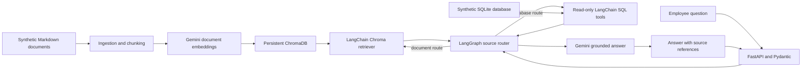

# Enterprise Healthcare Insurance AI Assistant

A learning project that demonstrates a grounded assistant over fictional healthcare-insurance documents and synthetic relational records. Every organization, group, plan, member, claim, provider, date, amount, and process example in this repository is invented. Do not add company documents, production extracts, or real personal or health information.

## What it demonstrates

- Document ingestion, section-aware chunking, Gemini embeddings, persistent ChromaDB, metadata-filtered LangChain retrieval, and source citations.
- LangGraph orchestration that routes to documents, fixed read-only SQL tools, or both; Gemini answers only from retrieved context.
- FastAPI endpoints with Pydantic request and response validation, bounded conversation context, and sanitized error logging.
- Repeatable offline tests and a live retrieval/source-coverage evaluation script.
- Docker packaging, GitHub Actions CI, and an Azure DevOps pipeline template.

The local relational database is SQLite so the demo runs without a database server. Its schema and seed data are in `scripts/create_synthetic_db.sql`. The database tools use fixed parameterized queries; they do not execute SQL generated from the user's question.

## Architecture



`POST /ingest` is the ingestion path. `POST /chat` is the query path. They share the persisted vector collection, while SQL lookups use a separate synthetic SQLite database.

## Project layout

```text
app/
  agents/       LangGraph router and conversation state
  database/     SQLite initialization and fixed queries
  evaluation/   Offline evaluation metrics
  models/       Pydantic API models
  rag/          ingestion, chunking, embeddings, Chroma, retriever
  routes/       chat and ingestion endpoints
  services/     Gemini and application factories
  tools/        allowlisted database tools
  static/       browser chat interface
documents/      five fictional Markdown references
evaluations/    synthetic RAG evaluation questions
scripts/        setup, validation, and evaluation commands
tests/          offline unit tests
```

## Local setup

Use Python 3.11 or 3.12 and run commands from this project directory in PowerShell:

```powershell
py -3.12 -m venv .venv
.\.venv\Scripts\Activate.ps1
python -m pip install -r requirements.txt
if (-not (Test-Path .env)) { Copy-Item .env.example .env }
```

Edit `.env` locally and set `GOOGLE_API_KEY`. Do not commit or share `.env`. `GEMINI_CHAT_MODEL` defaults to `gemini-3.8-flash`; `CHROMA_DIRECTORY` and `DATABASE_PATH` can be overridden. The selected Gemini model can change; use the model string available to your API account.

### Create the synthetic SQL database

The API initializes the database on first use. To create it and check the sample group before starting the API:

```powershell
python -m scripts.init_database
```

Expected output includes `Synthetic SQLite database is ready.` The synthetic seed includes `groups`, `plans`, `members`, `claims`, `renewals`, and `providers`, including the example IDs `ABC123`, `M1001`, and `P1001`.

### Build the Chroma index

The full corpus is indexed once with:

```powershell
python -m app.rag.vector_store --all
```

This sends the synthetic document chunks to Gemini for embeddings and saves them in `chroma_db/`. The command without `--all` embeds only one chunk for a small smoke run. Re-running the same command upserts stable chunk IDs rather than duplicating them.

### Start the API

```powershell
python -m uvicorn app.main:app --reload
```

Open [http://127.0.0.1:8000/](http://127.0.0.1:8000/) for the browser chat interface, or [http://127.0.0.1:8000/docs](http://127.0.0.1:8000/docs) to try the API directly. The service exposes:

| Endpoint | Purpose |
| --- | --- |
| `GET /health` | Process health; makes no Gemini request. |
| `POST /ingest` | Embed and index all synthetic documents by default. |
| `POST /chat` | Route a question to document retrieval, SQL tools, or both. |

Example PowerShell chat request:

```powershell
$renewalBody = @{
    question = "According to the renewal policy, why is group ABC123 on hold?"
    session_id = "demo-session-1"
} | ConvertTo-Json

Invoke-RestMethod `
    -Uri "http://127.0.0.1:8000/chat" `
    -Method Post `
    -ContentType "application/json" `
    -Body $renewalBody
```

The response includes an `answer`, `sources` with IDs such as `D1` and `S1`, `source_type` (`document`, `database`, or both), and a `session_id`. `D` sources are document chunks; `S` sources are structured database records. To filter document retrieval, set `document_type` to one of the supported values, such as `renewal_procedure` or `claims_workflow`.

## Evaluation and tests

Run the offline checks; they use fake embeddings and fake chat completions and do not call Gemini:

```powershell
python scripts/validate_documents.py
python -m unittest discover -s tests -v
```

To evaluate live retrieval, routing, and citation coverage against `evaluations/rag_cases.json`, first build the Chroma index, then run:

```powershell
python -m scripts.evaluate_rag
```

This evaluation makes Gemini embedding and chat requests and writes a synthetic-only report to `reports/rag_evaluation.json`. The simple scores check source hit rate, source routing accuracy, and citation presence; they are a learning baseline, not a clinical, coverage, or production-quality certification.

## Docker

Create `.env` as described above, then run:

```powershell
docker compose up --build
```

The API is available at `http://127.0.0.1:8000`. Compose stores the local Chroma files and SQLite database in named Docker volumes. Use `docker compose down` to stop the service; use `docker compose down --volumes` only when you intentionally want to remove the local indexed data and synthetic database.

## Free hosted demo (Render)

The repository includes `render.yaml` for a free Render web service. It serves the same browser chat at `/`, the API explorer at `/docs`, and a health check at `/health`. Render's free web services sleep after 15 minutes without traffic and lose local files when they sleep, restart, or redeploy. This app therefore rebuilds its Chroma index from the synthetic Markdown documents at startup when `AUTO_INGEST_ON_STARTUP=true`. A cold start can take longer and uses Gemini embedding quota again. The synthetic SQLite database is recreated automatically by the application when needed.

To deploy:

1. Push this repository and the `render.yaml` file to GitHub.
2. In Render, choose **New > Blueprint**, connect the GitHub repository, and select the branch containing `render.yaml`.
3. When Render asks for `GOOGLE_API_KEY`, enter your Gemini API key in Render's dashboard prompt. Never add it to `render.yaml` or GitHub.
4. Keep the service plan set to **Free**, then create the Blueprint and wait for the deploy to finish.
5. Open the service's `onrender.com` URL to use the chat. The first visit after it has slept may take about a minute while Render starts the service.

Use only the synthetic project data in this public demo. Render documents its free services as suitable for hobby projects and testing, not production; they have resource and usage limits. Gemini API free-tier quotas also apply, and startup re-indexing consumes embedding quota after the local files are cleared. Review current [Render free-service limits](https://render.com/docs/free) and [Gemini API pricing and quotas](https://ai.google.dev/gemini-api/docs/pricing) before deploying.

## GitHub and Azure DevOps

The GitHub Actions workflow `.github/workflows/ci.yml` validates the synthetic documents and runs the test suite on pushes and pull requests to `main`.

The Azure DevOps pipeline `azure-pipelines.yml` always runs verification. Its `PublishAndDeploy` stage is disabled by default with `deployEnabled: "false"`. To enable it, create the Azure Container Registry and Web App service connections, set pipeline variables `ACR_SERVICE_CONNECTION`, `ACR_LOGIN_SERVER`, `AZURE_SERVICE_CONNECTION`, and `AZURE_WEBAPP_NAME`, and add `GOOGLE_API_KEY` as a secret variable. Confirm that the Web App can pull the ACR image and that its `/home` storage is writable by the non-root container user. Then set `deployEnabled` to `true` for the main-branch pipeline.

The template sets `WEBSITES_ENABLE_APP_SERVICE_STORAGE=true` and places Chroma and SQLite under `/home` so local files can persist across App Service restarts. This single-instance local-file design is for learning. For horizontal scaling, replace SQLite and local Chroma storage with managed services and move conversation checkpoints to a persistent LangGraph checkpointer.

For GitHub, initialize a local repository if needed, create an empty GitHub repository, then add its URL as `origin` and push the `main` branch. Keep `.env`, `chroma_db/`, `data/`, and generated `reports/` out of source control.

## Design notes and limitations

- Data is synthetic. The assistant must not be used with real member data, company extracts, or confidential policy documents.
- The application uses read-only query functions with parameter validation and SQL parameters. It does not allow arbitrary SQL execution or claim/coverage decisions.
- LangGraph uses an in-memory checkpointer for this learning build. Session context is lost when the API process stops; the prompt uses only a short recent history window.
- Routing is deterministic and transparent: a synthetic ID or structured-data cue selects SQL; policy and procedure language selects RAG; a question with both selects both. Expand and evaluate the routing rules when adding new question types.
- Gemini API calls require a key configured locally or in the host's secret settings and may be subject to the account's current model access, quotas, and billing.
- The Azure pipeline is configuration only; it has not been connected to an Azure subscription or deployed from this repository.

## Resume bullets

- Built a synthetic healthcare-insurance assistant with Gemini embeddings, ChromaDB, LangChain retrieval, grounded answers, and source references across policy documents and structured records.
- Orchestrated document and SQL retrieval with LangGraph and read-only parameterized tools over fictional group, plan, member, claim, renewal, and provider data.
- Exposed chat, ingestion, and health endpoints with FastAPI and Pydantic; added in-memory conversation context, offline evaluation, Docker packaging, and GitHub Actions/Azure DevOps pipeline templates.

Describe this accurately as a personal learning project; do not present it as production healthcare deployment experience.
